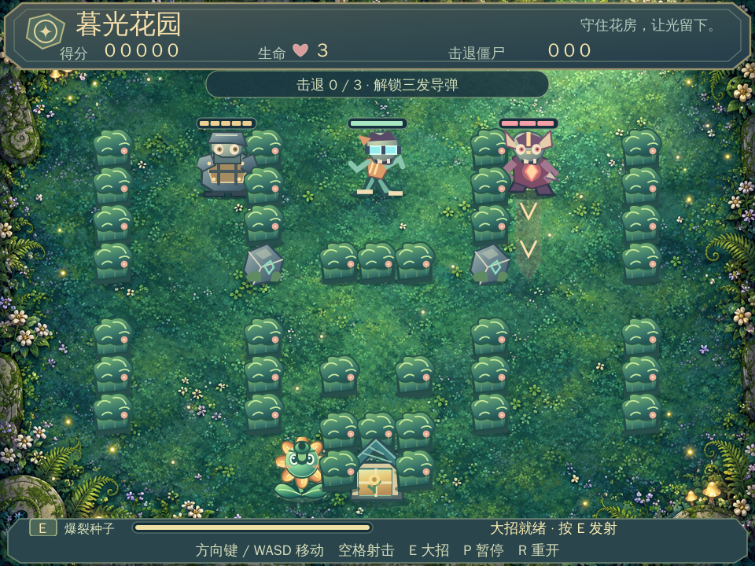

# 暮光花园 · 僵尸进化生存版

> `future-tank-defense` 初始版本：保留坦克大战移动、射击和基地保护玩法的花园主题生存游戏。

## 版本与实现状态

初始版本标签为 [`v0.1.0`](https://github.com/chenxiaoyuande/future-tank-defense/tree/v0.1.0)，对应提交 `a825606`。本 README 根据该版本源码补充说明，文档更新不移动初始标签。

当前实现使用植物、僵尸和花房主题，采用持续生存模式，而不是原先规划的未来城市坦克关卡模式。以下“已实现”指源码中存在相应逻辑或资源，并不代表已在 XBuilder 中完成运行验收。

## 团队分工

团队成员为赵彤平、曹雪晴、陈艺媛。三人分别负责产品、体验和 AI 工程交付，确保各项工作都有明确负责人。

### 赵彤平：产品负责人 / 游戏策划

负责目标用户、产品定位、玩法规则、敌人和道具设计、游戏节奏、需求拆解及最终验收标准；负责说明“为什么做这款游戏、为谁服务、有什么产品价值”。主要交付物包括产品介绍、玩法规则、功能优先级、验收清单和答辩中的产品价值说明。

建议提交记录：

- `docs: 补充游戏玩法和产品定位`
- `docs: 完善游戏验收标准`
- `docs: 更新游戏功能说明`

### 曹雪晴：视觉与体验负责人

负责暮光花园的视觉风格、玩家与僵尸形象、花房、树篱、道具、技能特效和 HUD 信息层级；检查玩家是否能快速识别自己、敌人、障碍、道具和冲锋预警；负责游戏截图、封面图、素材来源说明及 Demo 视频录制和剪辑。

建议提交记录：

- `assets: 优化花园主题游戏素材`
- `feat: 完善技能和道具视觉反馈`
- `docs: 补充素材来源和视觉说明`

### 陈艺媛：AI 工程与交付负责人

负责将产品需求拆解为开发任务，使用 XBuilder Copilot 和其他 AI 工具辅助 XGo / SPX 代码分析与实现，整合玩家、敌人、子弹、技能和道具逻辑；负责 `.xbp` 导入包、GitHub 分支与 Pull Request、版本标签、README、架构说明、AI 使用说明及最终交付检查。

建议提交记录：

- `feat: 完善玩家移动和射击逻辑`
- `feat: 增加敌人刷新与技能系统`
- `fix: 修复暂停和重新开始状态`
- `docs: 补充 AI 辅助开发说明`
- `chore: 整理 XBuilder 项目交付文件`

### 团队协作流程

1. 赵彤平提出玩法目标和验收标准，曹雪晴补充视觉体验要求，陈艺媛拆解开发任务。
2. 三人分别完成产品、素材体验和代码交付工作，并保留各自 Git 提交记录。
3. 每项变更从 `main` 创建功能分支，通过 Pull Request 提交，不直接向 `main` 推送。
4. 至少由另一名成员检查后合并，合并信息中说明变更内容和验证结果。
5. 截止前冻结仓库并创建最终版本标签，提交后不再修改代码仓库。

推荐分支：

```text
main
├── feature/product-design
├── feature/visual-experience
└── feature/game-integration
```

三人不得共用 GitHub 账号提交；提交信息应准确体现个人贡献。团队作品需要保留多人代码提交记录，不能只在最后一天一次性提交全部内容。

## AI 辅助开发记录

为体现 AI 工程效率，最终交付应保留以下过程证据：

- 使用 XBuilder Copilot 进行玩法咨询、API 查询和 XGo / SPX 示例生成。
- 使用 AI 将产品需求拆成移动、射击、碰撞、敌人、技能、道具、暂停和重开等任务。
- 使用 AI 分析源码、补齐入口和精灵脚本、检查状态重置及碰撞逻辑。
- 使用 AI 辅助生成或整理花园背景、角色、敌人、道具和 UI 素材。
- 使用 AI 进行逻辑检查、README、架构说明、演示讲稿和验收清单编写。
- 记录每次 AI 参与解决的问题、采用的结果、人工复核方式和最终效果；未经验证的生成结果不能直接作为完成证明。

## 最终交付清单

完整交付应包含：

- 全部源代码、资源和 `.xbp` 导入包。
- 产品介绍、玩法说明、目标用户和后续规划。
- 架构设计文档，包括 XBuilder / SPX / XGo、模块职责和状态流转。
- AI 使用说明，包括使用场景、提效过程和人工复核。
- Demo 视频和游戏截图，至少演示移动、射击、三类僵尸、武器升级、E 技能、道具、树篱破坏与再生、暂停、重开和失败场景。
- 多人 Git 提交记录、Pull Request 和最终版本标签。

**截止时间：2026 年 10 月 26 日（周一）9:00。截止后不再修改代码仓库。**

## 开始游戏

1. 打开 [XBuilder](https://x.qiniu.com/)。
2. 导入仓库根目录的 `暮光花园-僵尸进化生存版.xbp`。
3. 运行项目，点击游戏区域后使用键盘操作。

运行后直接进入游戏，当前没有独立的开始菜单流程。更新源码不会自动更新已经导入的项目，需要重新打包并导入。

### 操作说明

| 操作 | 按键 |
| --- | --- |
| 移动并改变射击朝向 | WASD / 方向键 |
| 普通射击，可按住连续发射 | 空格 |
| 爆裂种子技能 | E，冷却后需松开再按 |
| 暂停 / 继续 | P |
| 重新开始 | R |

## 初始版已实现功能

### 移动、战斗与生存规则

- 四方向移动与射击，包含地图边界、障碍物及角色碰撞。
- 玩家初始有 **3 条生命**，受伤后有短暂保护；生命耗尽时失败。
- 保护地图底部花房；花房被普通弹丸命中即摧毁并结束游戏，**没有独立的多段生命值系统**。
- 玩家普通攻击也可能击毁花房，应避免向花房射击；爆裂种子和樱桃爆炸不会伤害花房或玩家。
- 每击退一只僵尸增加 **100 分**，记录得分和累计击退数。
- 僵尸持续刷新，**没有固定击杀数通关或清敌胜利规则**。

### 三类敌人

| 类型 | 初始血量 | 行为 |
| --- | --- | --- |
| 重甲僵尸 | 5 | 慢速移动，可承受多次攻击 |
| 疾跑僵尸 | 1 | 快速移动 |
| 冲锋僵尸 | 3 | 周期性锁定方向、预警并冲刺，单次最多 72 单位 |

三类敌人各占一个循环刷新的位置，具有追踪玩家、遇阻改变方向、接触伤害和发射孢子的逻辑。当前是基础转向避障，不是完整寻路算法。

击退后先进入消散阶段，约 1 秒后尝试从随机场地边缘刷新，恢复满血，再经过约 0.4 秒传送阶段恢复行动。刷新点会检查障碍、玩家距离和花房附近区域；找不到可用位置或被阻挡时可能延后。

### 武器升级与技能

- 普通攻击初始每发造成 **1 点伤害**。
- 累计击退 **3 只僵尸**后，自动升级为三发扇形导弹，两侧分别偏转 16°。
- 损失生命保留武器升级；按 R 重开清除升级。
- E 释放爆裂种子，开场即可使用，冷却约 **5 秒**。
- 爆裂种子碰撞后爆炸，半径 **88 单位**，对范围内敌人造成 **3 点伤害**，并破坏树篱、清除孢子；不破坏符文石。

### 四种随机道具

| 道具 | 效果 |
| --- | --- |
| 坚果盾 | 抵挡 3 次伤害，最长 10 秒；吸收伤害后短暂保护 |
| 樱桃炸弹 | 拾取即爆炸，半径 100 单位，造成 5 点范围伤害，并破坏树篱、清除孢子 |
| 蘑菇 | 移动速度提高 55%，持续 8 秒 |
| 辣椒 | 普通射击及升级导弹每发伤害提高到 2，持续 8 秒；不增强爆裂种子和樱桃炸弹 |

开场约 5 秒首次尝试生成道具，此后约每 8 秒尝试生成；场上最多 3 件，未拾取约 18 秒后消失，靠近自动拾取。不同增益可同时存在，同类刷新持续时间，坚果盾补至 3 次而非无限叠加。

### 地图、暂停和重开

- 固定地图包含可破坏树篱和不可破坏符文石。
- 树篱被破坏后可通行，约 6 秒后开始生长，再经过约 1 秒恢复碰撞；角色占据位置时等待，避免直接将角色困住。
- P 暂停时停止游戏逻辑更新，包括移动、攻击、刷新、增益和生长计时。
- R 重开重建地图并重置生命、得分、击退数、武器升级、技能和道具状态。

时间数值由代码中的计数和 `wait 0.02` 推算，是设计时长；实际表现需在运行环境中验收。

### 界面与资源

仓库包含花园背景、角色与弹丸动画、敌人血条、得分与生命 HUD、技能冷却、增益状态、冲锋预警以及暂停和失败提示相关脚本与资源。另附中文字体子集和 SVG 字形资源。

预览图片由素材及逻辑快照合成，不等同于 XBuilder 实际运行截图：



## 当前未实现或未确认的内容

| 项目 | 初始版状态 |
| --- | --- |
| 独立开始菜单、按钮式流程 | 未实现完整流程，当前运行即开始 |
| 清敌通关、多关卡、关卡切换 | 未实现，当前为持续生存 |
| 花房多段血量与修复 | 未实现，普通弹丸命中即失败 |
| 科幻坦克外观、激光炮 | 属于原始创意，当前不是该实现 |
| 恢复生命的补给 | 当前四种道具不包含此功能 |
| 手机触屏操作 | 当前仅列出键盘控制，未完成触屏验收 |
| 音效、在线排行榜、多人联机 | 本次未确认有完整实现，不作为已交付能力 |

后续功能应另行确定，不能将原始规划当作初始版成果。

## 源码结构与技术

| 文件 | 用途 |
| --- | --- |
| `main.spx` | 游戏状态、移动、碰撞、敌人、武器、道具、刷新和重开 |
| `Actor.spx` | 角色、弹丸、道具及效果表现 |
| `Health.spx` / `Hud.spx` | 血条和 HUD |
| `Atmosphere.spx` / `Ability.spx` / `Buff.spx` | 环境效果、技能和增益显示 |
| `Frame.spx` / `Notice.spx` | 界面框架及状态提示 |
| `assets/` | 精灵、背景、字体和资源索引 |
| `gop.mod` / `go.mod` / `go.sum` | XGo 项目声明和 Go 依赖 |
| `builder-meta.json` | XBuilder 项目元数据 |
| `build_survival.py` / `pickup_art.py` / `art_utils.py` | 素材和打包相关工具 |
| `verify_logic.py` / `logic_test.go.txt` | 独立逻辑测试材料 |
| `verify_package.py` | 包和资源检查工具 |
| `REAMD.md` | 保留原文件名的历史交付说明 |

项目采用 XGo / SPX，并非 React、Vite 或 npm 项目。配置声明为：

- `gop.mod`：`xgo 1.6.0`，入口 `main.spx`。
- `go.mod`：`go 1.25.0`，SPX `v3.3.0`。

以上是配置声明，不是本机已复现的工具链版本。原交付文档中的历史版本和测试记录也不代表本次重新验证。

## 本地开发与工具限制

获取源码：

```bash
git clone git@github.com:chenxiaoyuande/future-tank-defense.git
cd future-tank-defense
```

SSH 克隆需要配置 GitHub 公钥，私有仓库还需访问权限。优先使用 XBuilder 导入包体验；本地构建方式需在适配环境后补充。

- `validate.sh`、`render_survival.cjs` 和素材脚本包含原开发机器的绝对路径，不能直接视为通用启动命令。
- `build_survival.py`、`verify_package.py` 使用父目录包路径，与仓库内随附包的位置不同。
- `verify_logic.py` 会在父目录创建测试材料，运行前应调整路径。
- 打包应选取项目目录内部文件，避免增加外层目录；排除 `.git`、`.codebuddy` 和缓存等非游戏数据。
- 当前仓库 README 已更新，但随附 `.xbp` 仍保留初始交付说明，本次不重新打包或改变游戏源码。

## 验证情况

已完成：

- [x] 初始同步时检查源码与导入包一致性（README 文档差异除外）
- [x] 初始同步时检查 ZIP 完整性与 JSON 格式
- [x] 本次读取游戏核心逻辑，区分实际实现与原始规划

尚待在 XBuilder 中执行：

- [ ] 导入成功并正常运行，检查控制台报错
- [ ] 验证移动、连射、碰撞和花房误伤
- [ ] 验证三类敌人的血量、攻击、冲锋与刷新
- [ ] 验证三杀升级、E 技能及四种道具
- [ ] 验证树篱再生及占位等待
- [ ] 验证暂停冻结计时，重开完整重置
- [ ] 验证生命耗尽和花房被毁均正确失败

随附逻辑测试文件存在，但本次没有执行 Go / XGo 编译、逻辑测试或浏览器运行测试。

## 协作与安全

XBuilder 内置 Copilot 可提供指引与代码示例，不直接修改项目。团队通过导出 `.xbp`、本地编辑、Git 版本管理、重新导入 XBuilder 的方式协作。建议使用功能分支，并明确文件分工。

- 原始 `garden-survival` 目录只读；修改在 `future-tank-defense` 中进行。
- 不提交密码、Token、SSH 私钥或带真实凭据的配置。
- 保留素材来源和字体许可，不把字体许可证当作全部源码的许可证。
- 项目尚未选择统一许可证，公开可见不等于授权开源使用。

团队名称暂定：**霓虹防线小队**。
