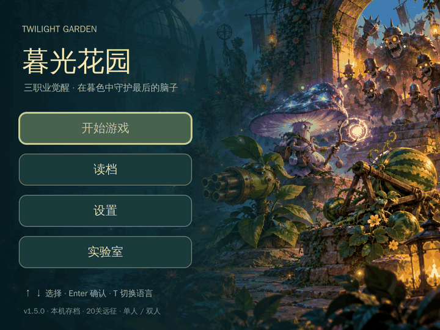
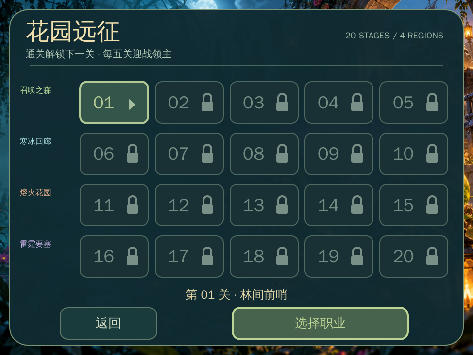
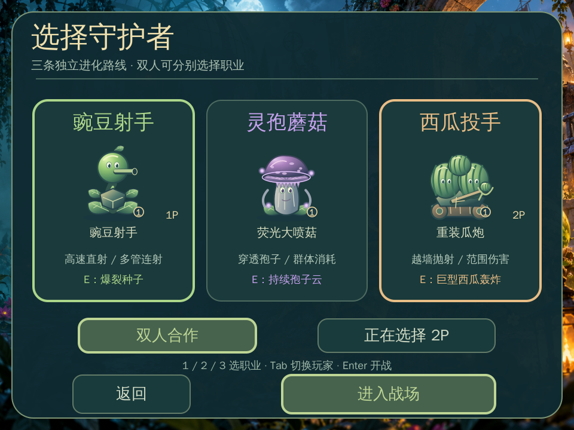
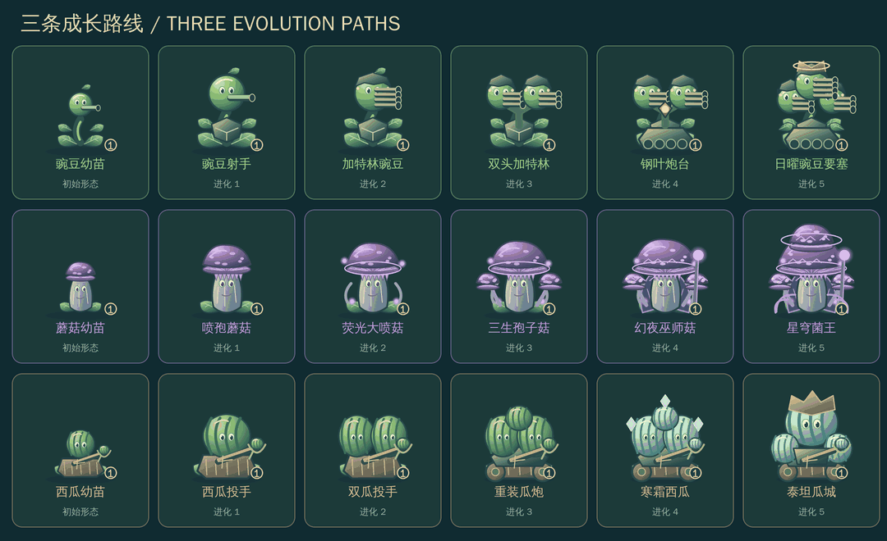
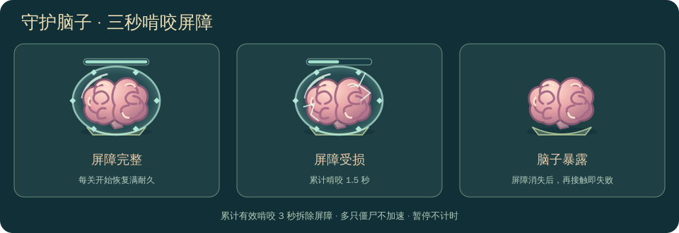
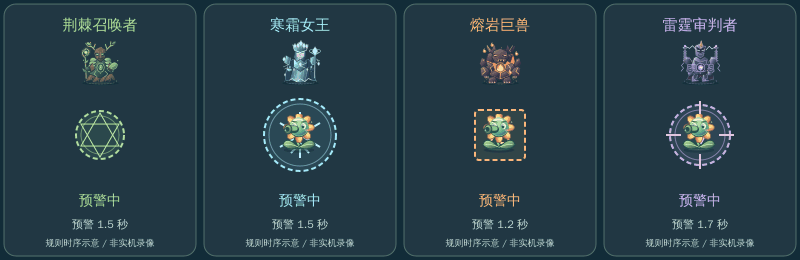
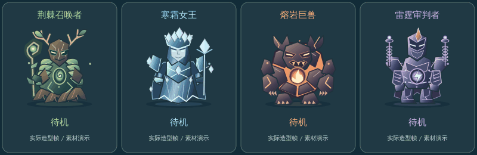

# 暮光花园 · 三职业觉醒 · v1.5.0

**选择你的植物，守住最后一颗脑子。**

一款基于 **XBuilder / XGo / SPX** 的俯视角守城游戏。你可以独自出发，也可以和伙伴同屏合作，穿过二十张地图，迎战召唤、寒冰、火焰与雷电四位领主。

**3 种职业 · 每职业 5 档进化 · 20 张地图 · 4 位 Boss · 本地双人 · 中英文 · 本机存档**

[下载最新版项目包](dist/暮光花园-v1.5.0-三职业觉醒版.xbp) · [快速开始](#快速开始) · [职业与进化](#职业与进化) · [游戏规则](#游戏规则) · [常见问题](docs/FAQ.md) · [English](docs/README.en.md)

*本文图片和动图由实际项目素材合成，不是 XBuilder 在线实机录像；示例余额和职业档位仅用于展示。媒体来源见 [制作说明](docs/media/README.md)。*

## 版本说明

当前交付为 **v1.5.0 · 三职业觉醒版**，文件名为 `暮光花园-v1.5.0-三职业觉醒版.xbp`。首页页脚、XBuilder 项目名称和包内 `version.json` 使用同一版本号。

[查看全部版本与历史下载](docs/VERSIONS.md) · [详细更新记录](docs/CHANGELOG.md)

| 本版重点 | 游戏中的变化 |
| --- | --- |
| 三职业 | 豌豆连射、蘑菇穿透、西瓜抛射，普通攻击和大招各有特点 |
| 独立成长 | 每职业有免费基础形态和五档进化，双人可选不同职业 |
| 动态首页 | 开始游戏、读档、设置、实验室四个入口，支持鼠标点击 |
| 顺序解锁 | 新档仅开放第一关，通关解锁下一关，已解锁关卡可以重玩 |
| 脑子屏障 | 脑子替代花房，默认屏障可抵挡累计三秒啃咬，带耐久条与裂纹 |
| 工程与版本 | 工具、测试、临时产物分目录，发布包放在 `dist/`，历史版本补齐编号 |
| 存档兼容 | TG3 保存三条路线与双方职业，继续读取 TG1 / TG2 旧存档 |

此前的双人、二十关、Boss 精修及中英文存档迭代见 [更新记录](docs/CHANGELOG.md)。

## 背景介绍

暮色中的花园中央放着一颗需要守护的脑子，一层屏障暂时挡住了僵尸的啃咬。荆棘召唤者、寒霜女王、熔岩巨兽和雷霆审判者封锁了通路，先锋军团正不断逼近。植物守护者必须在屏障被拆掉前拦住它们。

你将化身植物守护者，在树篱与石墙间移动、转向、射击。打通一条路，也可能让敌人更接近脑子；追击眼前的目标时，还要留意身后逼近的僵尸。每次远征获得的金币，都能让下一次出发的植物更强。

## 快速开始

1. 下载 [最新版 `.xbp` 项目包](dist/暮光花园-v1.5.0-三职业觉醒版.xbp)，在 [XBuilder](https://x.qiniu.com/) 中导入并运行。
2. 在首页点击 **开始游戏**，选择已解锁关卡。新档从 **第 1 关** 开始。
3. 选择单人或双人模式，再为玩家选择职业；双人可点击玩家切换按钮，分别设置 1P / 2P。
4. 点击 **进入战场**。1P 使用 **WASD / 空格 / E**，2P 使用 **方向键 / J / K**。
5. 守住脑子，完成清敌或 Boss 目标；过关后按 **Enter** 继续。

有存档时，从首页 **读档 → 继续存档** 进入；想升级时，从首页进入 **实验室**。玩家无需安装 Go 或 XGo。已有旧项目需要重新导入新版包，文件更新不会自动同步到已导入的项目。

| 选关：新档只开放第一关 | 职业：双人分别选择 |
| :---: | :---: |
|  |  |

## 首页导航

| 入口 | 用途 |
| --- | --- |
| 开始游戏 | 选关 → 选择人数和职业 → 进入战场；建立新的关卡检查点 |
| 读档 | 从已保存关卡起点继续，也可导出或恢复备份码 |
| 设置 | 切换中文 / English，并记住选择；也可随时按 T |
| 实验室 | 选择进化路线，使用共享金币购买下一档 |

## 职业与进化

| 职业 | 普通攻击 | 专属大招 | 进化特征 |
| --- | --- | --- | --- |
| 豌豆射手 | 高速直射，成长后连射与散射 | 爆裂种子，范围伤害 | 单管 → 加特林 → 双头 → 履带炮台 → 日曜要塞 |
| 灵孢蘑菇 | 紫色孢子穿透敌人，第三档起双发 | 持续孢子云，消耗范围内敌人 | 菌盖扩大、荧光菌褶、侧生菌盖、法杖与星穹冠 |
| 西瓜投手 | 越过障碍抛射，落地造成范围伤害 | 巨型西瓜轰炸 | 双瓜、重装炮架、寒霜与泰坦形态；第四档起命中减速 |

**金币共享，路线独立。** 两人选同一职业时共享该职业档位；选择不同职业时各用自己的路线。换职业会保留已经购买的进化。

每条路线有 **免费基础形态 + 五档付费进化**，依次消耗 **100 / 250 / 500 / 900 / 1500 金币**，单条升满共 3250 金币。进入实验室后，先点顶部职业标签，再点 **购买进化**。

疾跑、重甲、冲锋先锋分别奖励 **10 / 15 / 12 金币**；召唤物奖励 **2 金币**；四位 Boss 分别奖励 **100 / 150 / 200 / 250 金币**。金币与本局得分分开保存，失败、重试和换关不会清空钱包。

[查看六形态路线、攻击数值和升级费用](docs/EVOLUTION.md)

## 游戏规则

| 规则 | 说明 |
| --- | --- |
| 守护目标 | 保护战场底部的脑子，完成当前关卡目标 |
| 生命与失败 | 每人三条生命；脑子被毁或所有玩家出局时失败 |
| 僵尸攻击 | 普通僵尸与 Boss 不发射子弹；接触玩家造成伤害，贴近脑子后停下啃咬 |
| 脑子屏障 | 每关默认满耐久；累计啃咬三秒后消失，多只僵尸不会加速；屏障消失后的下一次接触触发失败 |
| 普通关 | 每主题前四关清理先锋；配额为 5 + 关卡号，同时最多三个先锋 |
| Boss 关 | 第 5 / 10 / 15 / 20 关直接挑战领主 |
| 解锁 | 通关开放下一关；锁定关不能通过快捷键或存档入口绕过 |
| 双人合作 | 双方独立生命、技能冷却和临时增益，队友之间免伤，己方攻击不伤脑子 |
| 连续闯关 | 过关后恢复生命和技能，保留总分、击退数、职业及永久进化 |
| 最终胜利 | 第 20 关击败雷霆审判者，完成远征 |

一名队友出局后，另一人可以继续；成功过关会让双方重新加入。普通敌人的生命与移动速度随关卡推进增强，冲锋僵尸的冲刺间隔逐关缩短；Boss 保留各主题的范围技能。

脑子上方的耐久条与裂纹显示屏障状态。打断啃咬后耐久保持不变，暂停和菜单不计时；重试、换关或读档回到关卡起点时，屏障恢复完整。己方攻击与 Boss 区域技能不会扣屏障耐久。

## 玩法介绍

### 战斗操作

| 操作 | 1P：金色标识 | 2P：蓝色标识 |
| --- | --- | --- |
| 移动与转向 | WASD | 方向键 |
| 普通攻击 | 按住空格 | 按住 J |
| 职业大招 | E | K |

单人也可用方向键移动。大招需要松开后再次按下，冷却随职业和档位变化。本地双人使用同一台电脑和同一副键盘。

| 场景 | 常用按键 |
| --- | --- |
| 首页 | ↑ / ↓ 选择，Enter 确认；N 继续存档 |
| 选关 | 方向键选择，Enter 进入职业页；1 / 2 选择人数 |
| 职业选择 | 1 / 2 / 3 选职业；双人按 Tab 切玩家；Enter 开战 |
| 战斗 | P 暂停 / 继续，R 重试，O 保存关卡起点，M 返回首页 |
| 结算 | 过关后 Enter 下一关；R 重试，M 首页 |
| 实验室 | 1 / 2 / 3 切路线，U 购买，C / V 备份 / 恢复，M 返回 |
| 读档 | N 继续，C / V 备份 / 恢复，M 返回 |
| 通用 | T 切换语言；首页、选关与结算页可用 B 进入实验室、S 打开读档 |

F / G / H / L 可在选关页查看四个主题起点，仍受关卡锁定限制。[完整按键与二十关地图表](docs/GAMEPLAY.md)

### 四境与 Boss

每五关构成一个主题：**四关清敌 + 一关领主**，按顺序解锁。

| 关卡 | 主题 / Boss | 预警与应对 |
| --- | --- | --- |
| 01–05 | 暮光花园 / 荆棘召唤者 | 绿色符阵即将召唤援军，优先清理包围你的敌人 |
| 06–10 | 寒霜庭院 / 寒霜女王 | 蓝色圆环即将形成冰区，提前离开，避免持续减速 |
| 11–15 | 熔岩遗迹 / 熔岩巨兽 | 橙色方框连成火线，离开整条燃烧范围 |
| 16–20 | 雷鸣圣域 / 雷霆审判者 | 紫色准星固定后会落雷，立刻离开标记 |

所有预警阶段都不会直接造成伤害。Boss 半血后移动加快、技能更频繁，援军或攻击区域增加。

展开查看技能预警动图与 Boss 动作

技能动图按代码中的时序制作，用于说明避让思路。生命、预警时长和伤害规则见 [完整玩法指南](docs/GAMEPLAY.md)。

### 道具与掩体

坚果盾抵挡三次伤害，最长十秒；樱桃炸弹立即造成范围伤害；蘑菇道具提高移速 55%，持续八秒；辣椒让普通攻击额外增加一点伤害，持续八秒。道具归实际拾取者，同类增益刷新时间。

树篱可打破，约六秒后开始再生；符文石永久存在。不要把临时打通的通道当成永久退路。双人可以分工拦截侧翼、保护脑子，并把道具留给更需要的人。

## 存档与语言

**继续游戏会回到保存关卡的起点。** 双方恢复生命，敌人与道具重新生成；半途位置、飞行子弹、临时增益和 Boss 当前血量不恢复。

| 自动保留 | 何时记录 |
| --- | --- |
| 金币、累计收入、三条进化路线 | 收益或升级后保存 |
| 关卡起点、双方职业、人数、起点得分与击退数 | 开始、重试、通关或手动存档 |
| 最高通关与语言 | 通关或切换语言时保存 |

仅保留 **一个关卡检查点**；开始新局会替换它。进入新局前，可在读档页先导出备份。旧 TG1 / TG2 的钱包与原进化保留，原进化转入豌豆路线，蘑菇和西瓜从基础形态开始。

存档属于同一浏览器配置和同一站点来源。换设备、换浏览器或清理站点数据后不会自动继承，请使用备份码迁移。语言可在首页 **设置** 中选择，也可按 **T** 随时切换。

[存档范围、旧档迁移与备份方法](docs/SAVES_AND_LANGUAGE.md) · [读不到存档等常见问题](docs/FAQ.md)

## 代码说明

XBuilder 所需的 `main.spx`、精灵脚本和 `assets/` 保留在工程根目录。开发工具位于 `tools/`，测试位于 `tests/`，地图目录位于 `data/`，临时生成内容位于 `.build/`。从工程目录执行 `python3 tools/project.py --help` 查看统一命令。

规则位于舞台脚本，精灵读取共享状态显示角色与界面。修改游戏优先从对应源文件进入：

| 想修改什么 | 主要文件 |
| --- | --- |
| 关卡、伤害、职业、金币与存档 | [main.spx](main.spx) |
| 角色、弹道与技能动画 | [Actor.spx](Actor.spx)、[classes_art.py](tools/classes_art.py) |
| 脑子与屏障显示 | [Brain.spx](Brain.spx)、[brain_art.py](tools/brain_art.py) |
| 首页与可点击菜单 | [Splash.spx](Splash.spx)、[HomeDecor.spx](HomeDecor.spx)、[UIAction.spx](UIAction.spx)、[StageCard.spx](StageCard.spx)、[front_end_art.py](tools/front_end_art.py) |
| Boss 外观与主题素材 | [boss_art.py](tools/boss_art.py)、[campaign_art.py](tools/campaign_art.py) |
| 状态栏与提示 | [Campaign.spx](Campaign.spx)、[Notice.spx](Notice.spx)、[Wallet.spx](Wallet.spx) |
| 构建与文档 | [build_survival.py](tools/build_survival.py)、[write_docs.py](tools/write_docs.py)、[write_profession_docs.py](tools/write_profession_docs.py) |

详细状态表、实体编号和数据流见 [代码架构](docs/ARCHITECTURE.md)；环境、测试命令与媒体生成步骤见 [开发指南](docs/DEVELOPMENT.md)。

## 验证状态

已通过 **74 项 Go 规则测试、4 项 WebAssembly 存储测试**，以及 WebAssembly 编译、资源完整性和文档链接检查。素材预览已检查页面布局；XBuilder 在线整体验收尚未完成。

当前交付是可编辑 `.xbp` 项目，提供本地双人和本机存档；联网、云存档、支付及独立安装包不在本版功能内。验证范围见 [开发指南](docs/DEVELOPMENT.md)。

## 文档导航

| 文档 | 内容 |
| --- | --- |
| [完整玩法](docs/GAMEPLAY.md) | 按键、二十关、敌人、Boss、道具 |
| [职业与进化](docs/EVOLUTION.md) | 六形态路线、攻击数值、费用与金币 |
| [存档与语言](docs/SAVES_AND_LANGUAGE.md) | 继续、备份、旧档迁移和保存范围 |
| [常见问题](docs/FAQ.md) | 导入、锁关、键盘、存档与升级问题 |
| [代码架构](docs/ARCHITECTURE.md) | 模块、状态机、实体和修改入口 |
| [开发指南](docs/DEVELOPMENT.md) | 构建、验证和媒体生成 |
| [更新记录](docs/CHANGELOG.md) | 各阶段功能变化 |
| [媒体说明](docs/media/README.md) | 图片、动图与首页美术来源 |

README 的早期展示结构参考了 [Qiniu-ERE/zero](https://github.com/Qiniu-ERE/zero/blob/main/README.md)，当前说明以本项目实现为准。
