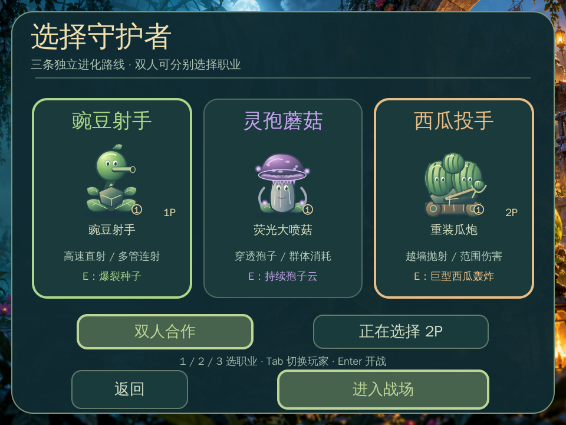
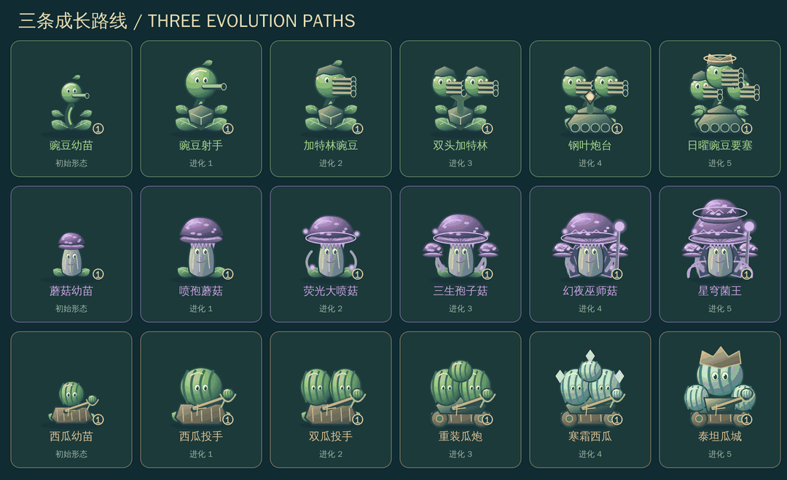
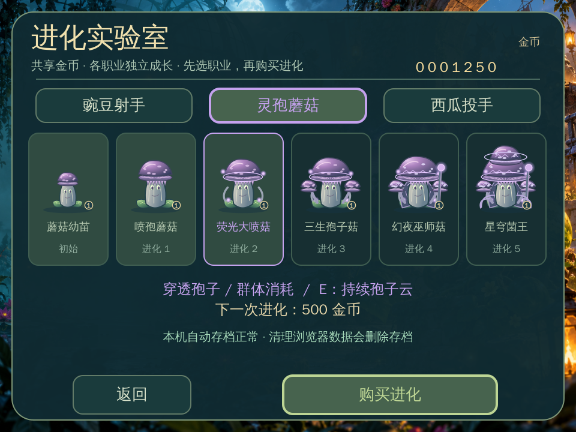

# 职业、金币与独立进化

[返回项目说明](../README.md) · [存档与语言](SAVES_AND_LANGUAGE.md)

## 选择职业

首页点击开始游戏，在已解锁关卡中选择一关，再选职业。单人选择 1P；双人可分别为 1P、2P 选职业，点击“正在选择”或按 Tab 切换当前玩家。职业页的 1 / 2 / 3 对应豌豆、蘑菇、西瓜；Enter 确认开战。

金币是团队共享钱包。每个职业分别拥有基础形态和五档永久进化；同职业的两名玩家共用该职业档位，不同职业互不影响。选定职业不会消耗金币，不会重置另外两条路线。

## 六形态路线

| 档位 | 本次费用 | 豌豆 | 蘑菇 | 西瓜 |
| --- | --- | --- | --- | --- |
| 基础 | 免费 | 豌豆幼苗 | 蘑菇幼苗 | 西瓜幼苗 |
| 进化 1 | 100 | 豌豆射手 | 喷孢蘑菇 | 西瓜投手 |
| 进化 2 | 250 | 加特林豌豆 | 荧光大喷菇 | 双瓜投手 |
| 进化 3 | 500 | 双头加特林 | 三生孢子菇 | 重装瓜炮 |
| 进化 4 | 900 | 钢叶炮台 | 幻夜巫师菇 | 寒霜西瓜 |
| 进化 5 | 1500 | 日曜豌豆要塞 | 星穹菌王 | 泰坦瓜城 |

一条路线升满消耗 3250 金币；三条全部升满合计 9750 金币。逐档购买，金币不足或已满档不会扣费。结构变化包括炮管 / 头部数量、履带、菌盖、发光菌褶、长袍、法杖、抛射机械与冰晶，不依赖单纯换色。

## 攻击规则

以下数值以 50 个逻辑帧为一秒，t 表示当前进化档位（0–5）。

| 职业 | 普通攻击 | 射击间隔 | 专属大招 | 大招冷却 |
| --- | --- | --- | --- | --- |
| 豌豆 | 每弹 1+⌊t/2⌋ 点；t≥2 双发；团队三杀后 3 发散射 | t=0/1 为 14−t 帧；t≥2 为 10−t 帧 | 爆裂种子，3 点范围伤害 | 250−15t 帧 |
| 蘑菇 | 每弹 1+⌊t/2⌋ 点；可额外穿透 1+⌊t/2⌋ 个目标；t≥3 双发 | 22−t 帧 | 前方孢子云持续 150 帧，每 25 帧造成 1+⌊t/3⌋ 点范围伤害 | 300−15t 帧 |
| 西瓜 | 越墙抛射，30 帧落地；每次 3+⌊t/2⌋ 点、半径 30+4t | 38−3t 帧 | 巨型西瓜，40 帧落地；8+t 点、半径 65+4t | 350−20t 帧 |

蘑菇每发孢子对同一目标最多命中一次；石墙仍会挡住孢子。西瓜优先选择朝向前方 185 距离内最近的敌人，找不到则投向前方；只在落地位置判伤，不追踪敌人后续移动。西瓜第四档起，命中目标减速至 55%，持续 80 帧，Boss 也可受影响。冷却和移速效果不等于冻结敌人。

己方攻击不会伤害队友或脑子。辣椒给普通弹 / 普通西瓜额外加一点伤害。飞行中的弹体记录发射时职业、档位、伤害，切换 UI 或升级不会修改已发出的攻击。

## 实验室与收入

首页点击实验室，顶部选择路线，下方购买下一档。也可在战斗外按 B，按 1 / 2 / 3 切路线、U 购买、M 返回来源页面；战斗中不能购买。

疾跑 / 重甲 / 冲锋先锋分别奖励 10 / 15 / 12 金币；召唤物 2 金币；四个 Boss 分别奖励 100 / 150 / 200 / 250 金币。每个敌人只结算一次。重试、失败、返回首页或下一关不会清空钱包与路线。

## 保存与迁移

三条路线与钱包自动存到本机。TG1 / TG2 的旧进化档位迁移到豌豆路线，保留旧钱包，蘑菇与西瓜为基础形态。读档页可点击导出 / 恢复备份。清理站点数据或换设备不会自动同步，详见存档指南。

动图与图片为实际素材合成预览，示例余额不代表赠送金币，也不是 XBuilder 实机录像。
