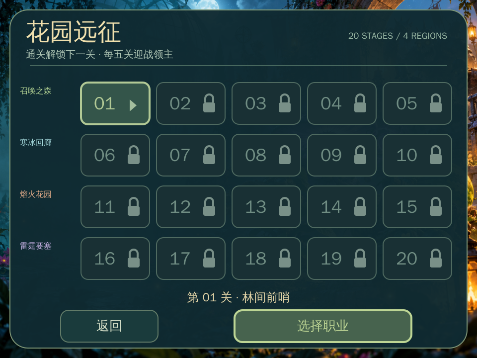
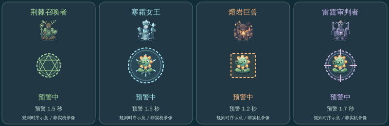
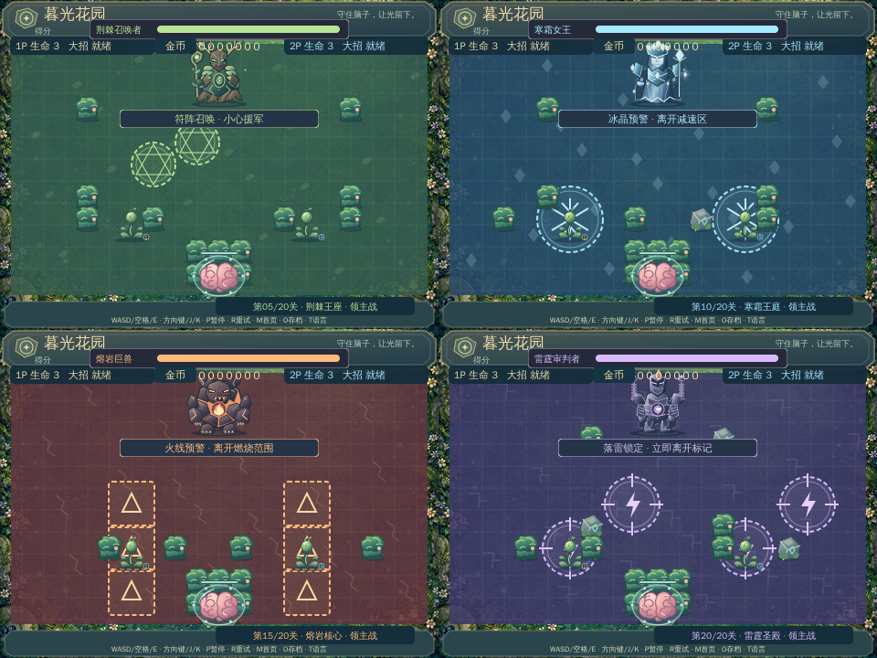

# 完整玩法指南

[返回项目说明](../README.md) · [代码架构](ARCHITECTURE.md)

## 目标与流程

保护战场底部的脑子，完成当前关卡目标。每个主题有四关清敌和一关领主战；普通关清完配额后直接过关，Boss 关直接出现领主。第 20 关获胜后结束本次远征。

双方各有三条生命。僵尸不发射子弹，触碰玩家造成伤害，贴近脑子时停下啃咬屏障；脑子失去屏障后被接触，或所有玩家都耗尽生命时失败。失去生命后重生会避开队友与障碍物；一人出局不会立刻结束双人游戏，存活者可以继续战斗。玩家接触伤害遵守护盾和重生保护，持续重叠不会每帧扣血。

## 脑子与三秒屏障

脑子是战场底部的守护目标，开局自带一层完整屏障。屏障有 150 帧耐久，以每秒 50 个逻辑帧计，累计被啃咬三秒后消失。多个普通僵尸、召唤物或 Boss 一起啃咬时，每帧仍只扣一点，不会瞬间拆掉屏障。

脑子上方的耐久条逐步缩短，屏障随耐久出现裂纹。清掉或引走啃咬者会停止损耗，剩余耐久不自动恢复；屏障消失的那一帧仍保住脑子，下一次接触才会失败。己方攻击与 Boss 范围技能不会损坏屏障。

暂停、首页或其他菜单不推进啃咬计时。重试、进入下一关和读档恢复关卡起点时，都重建满耐久屏障，不保存半途损耗。

过关后按 Enter 进入下一关：保留团队得分、击退数及导弹升级，双方恢复生命，技能和临时增益重置。按 R 或直接选关会开始新的一局；金币和永久进化独立保存，不会因此清空，见 [进化与存档](EVOLUTION.md)。

## 操作速查

| 操作 | 按键 |
| --- | --- |
| 1P 移动 / 普攻 / 大招 | WASD / 空格 / E |
| 2P 移动 / 普攻 / 大招 | 方向键 / J / K |
| 切换语言 / 存档中心 / 手动存档 / 继续 | T / 战斗外 S / O / N |
| 暂停 / 重试 / 首页 | P / R / M |
| 选择单人 / 双人 | 职业页点击人数按钮；选关页也可按 1 / 2 |
| 选关 / 职业确认 / 下一关 | 方向键 / Enter / Enter |
| 选择职业 / 切换玩家 | 职业页 1 / 2 / 3；Tab 切换玩家 |
| 查看主题起点 | F / G / H / L，对应 1 / 6 / 11 / 16 关，不能绕过锁定 |
| 进化 / 购买 / 备份 / 恢复 | 战斗外 B / U / C / V，M 返回原界面 |

普通射击可以按住；大招释放后要松开，再次按下才能触发下一次。单人也支持方向键移动。双人共用电脑和键盘，尚未实现联网合作。

首页点击开始游戏后进入选关，再进入职业页选择单双人和三种职业。新档只开放第一关，通关后逐关解锁；详见 [职业、攻击与独立进化](EVOLUTION.md)。

## 二十张地图

| 关卡 | 主题 | 地图名 | 目标 |
| --- | --- | --- | --- |
| 01 | 暮光花园 | 林间前哨 | 击退 6 只先锋 |
| 02 | 暮光花园 | 藤蔓长廊 | 击退 7 只先锋 |
| 03 | 暮光花园 | 花影岔路 | 击退 8 只先锋 |
| 04 | 暮光花园 | 荆棘回廊 | 击退 9 只先锋 |
| 05 | 暮光花园 | 荆棘王座 | 击败荆棘召唤者 |
| 06 | 寒霜庭院 | 初雪边境 | 击退 11 只先锋 |
| 07 | 寒霜庭院 | 冰封堤坝 | 击退 12 只先锋 |
| 08 | 寒霜庭院 | 碎晶迷阵 | 击退 13 只先锋 |
| 09 | 寒霜庭院 | 霜环要塞 | 击退 14 只先锋 |
| 10 | 寒霜庭院 | 寒霜王庭 | 击败寒霜女王 |
| 11 | 熔岩遗迹 | 灰烬入口 | 击退 16 只先锋 |
| 12 | 熔岩遗迹 | 熔炉防线 | 击退 17 只先锋 |
| 13 | 熔岩遗迹 | 焦土裂隙 | 击退 18 只先锋 |
| 14 | 熔岩遗迹 | 赤焰堡垒 | 击退 19 只先锋 |
| 15 | 熔岩遗迹 | 熔岩核心 | 击败熔岩巨兽 |
| 16 | 雷鸣圣域 | 雷云边境 | 击退 21 只先锋 |
| 17 | 雷鸣圣域 | 电弧屏障 | 击退 22 只先锋 |
| 18 | 雷鸣圣域 | 风暴迷阵 | 击退 23 只先锋 |
| 19 | 雷鸣圣域 | 天雷回廊 | 击退 24 只先锋 |
| 20 | 雷鸣圣域 | 雷霆圣殿 | 击败雷霆审判者，远征胜利 |

已解锁关卡可以重玩。新档后续关卡锁定，需顺序通关；选中锁定关不会允许开战。最高通关进度会自动保存。

普通关同时最多有三个先锋，按有限配额补充。相对第一关，移动速度每关增加 2.5%，冲锋僵尸的冲刺间隔每关缩短两个逻辑帧；每进入一个新主题，三类先锋生命均增加一点。

## 敌人与计分

| 类型 | 第一主题生命 | 行动特点 |
| --- | --- | --- |
| 重甲僵尸 | 5 | 慢速，适合用范围伤害或扇形导弹处理 |
| 疾跑僵尸 | 1 | 高速，留意它绕过掩体接近脑子 |
| 冲锋僵尸 | 3 | 蓄力预警后冲刺，最多三格，遇障碍停止 |

三类先锋会从战场边缘的安全位置出现传送效果。普通敌人或召唤物击退计 100 分；领主击退共计 1000 分。领主召唤物贡献得分和导弹升级，但不计入先锋配额。

## 四种领主机制

*动图按代码中的预警时间生成，仅演示规则与避让思路，未录制实际对局。*

| Boss | 生命：单人 / 双人 | 预警 | 生效后 |
| --- | --- | --- | --- |
| 荆棘召唤者 | 24 / 40 | 绿色六芒星符阵，1.5 秒 | 召唤援军；普通阶段同时最多 4 只，半血后最多 6 只 |
| 寒霜女王 | 36 / 52 | 蓝色雪花圆环，1.5 秒 | 半径 36 的冰区持续 3 秒，移速减半，不直接造成伤害 |
| 熔岩巨兽 | 48 / 64 | 橙色方框火线，1.2 秒 | 横 / 纵三块火区持续 2 秒，区域内周期性造成伤害 |
| 雷霆审判者 | 60 / 76 | 紫色准星圆环，1.7 秒 | 在固定坐标落雷，命中瞬间伤害一次，短暂保留约 0.32 秒特效 |

召唤符阵生效时若位置被角色或障碍物占据，会取消该位置的召唤。召唤者普通阶段每轮最多召唤两只，半血后每轮最多三只，始终受同时存在数量限制。

四领主都会移动并通过接触造成伤害，不再射出孢子。召唤、冰区、火焰和雷电技能保留。半血后移动更快、技能间隔缩短，并增加援军或攻击区域数量。所有预警阶段均不会直接伤害或减速玩家。

火焰与雷电遵守玩家的护盾及受伤保护规则，不直接破坏脑子。冰区里的蘑菇加速仍会生效，但最终移速再乘以减速系数。领主死亡、重试和下一关会清理区域与召唤物。

*以上为实际素材和逻辑快照合成图，非在线实机截图。*

## 武器和道具

| 武器 | 伤害 | 使用规则 |
| --- | --- | --- |
| 豌豆 / 蘑菇普攻 | 基础每发 1，进化最高 3 | 按住连发；受树篱与符文石阻挡；蘑菇可穿透敌人 |
| 西瓜普攻 / 大招 | 基础范围 3 / 8，随档位增长 | 抛射越过障碍，落地判伤；第四档起减速 |
| 蘑菇大招 | 持续 3 秒，每 0.5 秒造成 1–2 点 | 前方孢子云持续消耗敌人 |
| 豌豆三发散射 | 每枚为当前普通伤害 | 团队累计击退三只敌人后豌豆职业解锁；两侧偏转 16° |
| 爆裂种子大招 | 范围伤害 3 | 半径 88，基础冷却五秒，进化最低 3.5 秒；再次释放需松开再按 |

己方攻击不会伤害队友或摧毁脑子。范围攻击可破坏树篱，不能摧毁符文石。

| 道具 | 效果 | 时间 |
| --- | --- | --- |
| 坚果盾 | 抵挡三次伤害；每次吸收后短暂保护，避免瞬间耗尽 | 最长 10 秒 |
| 樱桃炸弹 | 以拾取者为中心造成五点伤害，半径 100 | 立即生效 |
| 蘑菇 | 移速提高 55% | 8 秒 |
| 辣椒 | 普通攻击伤害增加一点，导弹每枚也受益 | 8 秒 |

开场约五秒生成首件道具，此后约每八秒尝试生成；同时最多三件，未拾取约十八秒后消失。道具归实际拾取者，不同增益可共存；同类增益刷新时间，坚果盾重置为三次。

## 掩体与合作建议

树篱破坏后留下可通行树桩，约六秒后开始生长，再用约一秒恢复；有人占据时等待。符文石永久存在。不要把临时打通的通道当成永久安全路线。

- 一人处理侧翼和先锋，另一人拦截接近脑子的僵尸。
- Boss 出现标记后先观察安全方向，利用预警时间离开范围。
- 道具优先让更需要的人拾取，护盾和加速可用于穿越危险区域。
- 队友出局后继续保守作战，过关可以让双方重新加入。

暂停会停止全部战斗计时；返回首页或进入菜单也会停止战斗。金币与进化使用本机存档；当前没有局内救援、联网、手柄适配或云存档。

存档与语言的完整说明见 [存档与语言指南](SAVES_AND_LANGUAGE.md)。继续从关卡起点开始，最高通关、模式、语言与金币进化一并保留。
