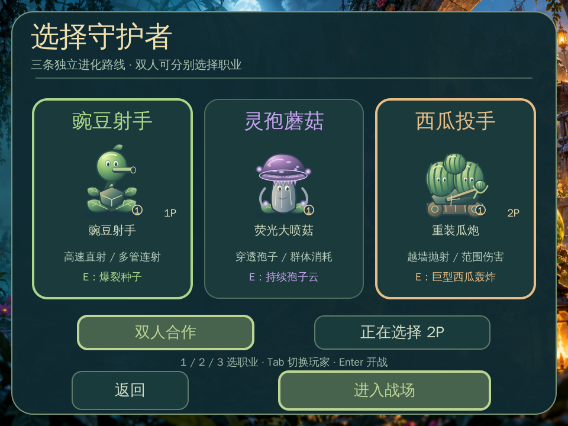

# Twilight Garden — Three Paths Awakening · v1.5.0

Three plant classes, five independent evolution tiers per class, 20 sequential stages, four elemental bosses, local co-op, English / Chinese UI and local saves.

[中文说明](../README.md) · [Download project](../dist/暮光花园-v1.5.0-三职业觉醒版.xbp) · [Evolution details](EVOLUTION.md) · [Troubleshooting (Chinese)](FAQ.md)

## Start playing

Import `暮光花园-v1.5.0-三职业觉醒版.xbp` into [XBuilder](https://x.qiniu.com/). The animated home has Start Game, Load Game, Settings and Laboratory buttons. Settings or T switches language.

Start Game → unlocked stage → class selection → Enter Battle. A new save starts with only Stage 1 unlocked; clearing each stage unlocks the next. Locked stages cannot be started through keyboard shortcuts or checkpoints. In co-op, select a different class for each player by clicking the player selector or pressing Tab. Keys 1 / 2 / 3 select classes on that page.

| Home button | Purpose |
| --- | --- |
| Start Game | Choose an unlocked stage, player mode and classes; create a new checkpoint |
| Load Game | Resume the existing checkpoint or export / restore a backup |
| Settings | Choose English or Chinese and save the preference |
| Laboratory | Choose a class route and buy its next permanent evolution |

| Class | Normal attack | Ultimate |
| --- | --- | --- |
| Pea Gunner | Fast shots, Gatling and spread upgrades | Explosive seed |
| Spore Mage | Piercing spores, twin shots at tier 3 | Lingering spore cloud |
| Melon Artillery | Lob over walls, impact area damage; slow at tier 4 | Giant melon bombardment |

| Action | Player 1 | Player 2 |
| --- | --- | --- |
| Move | WASD | Arrow keys |
| Shoot | Space | J |
| Ultimate | E | K |

P pauses, R retries, M returns home (or back from a submenu). Enter advances after a stage clear. N resumes a checkpoint. Outside combat, B opens the laboratory and S opens the save panel. O saves a stage-start checkpoint. C / V exports or restores a backup in the save or laboratory page.

## Evolution and persistence

The wallet is shared; classes evolve independently. Players choosing the same class share its tier. Each path has a free base plus five paid tiers costing 100 / 250 / 500 / 900 / 1500 coins. Select a route in the Laboratory, then click Evolve or press U. Changing class does not erase other routes.

TG3 saves include all three tiers, both players' classes, coins, unlocks, checkpoint, stage-entry score / kills and language. There is one checkpoint; starting a new game replaces it. Export a backup first if you want to keep the previous run. TG1 / TG2 remain readable; old evolution becomes the pea route. Old checkpoints beyond the unlocked stage are clamped to the next uncleared stage.

Load resumes the stage from its beginning, restoring health and rebuilding enemies. It does not restore positions, projectiles, temporary buffs or a mid-fight boss. Storage belongs to the same browser profile and site origin. Clearing site data deletes it; use Backup / Restore to migrate.

## Campaign

Protect the brain. Each stage starts with a full barrier. Zombies stop nearby and gnaw: three accumulated seconds of active biting remove the barrier, regardless of how many zombies bite together. Interrupted biting preserves remaining durability; pauses and menus stop the timer. The next contact after the barrier breaks destroys the brain. Retrying or resuming a stage restores the barrier. Friendly attacks and boss zones do not damage it.

Zombies and bosses do not shoot projectiles; contact hurts players. Bosses retain their summoning, frost, fire and lightning skills. Boss stages are 5 / 10 / 15 / 20. Clear a quota or defeat the boss to advance. The run fails when the brain is destroyed or all players lose their lives.

Art previews are asset compositions, not engine recordings. WebAssembly compilation, logic tests and storage tests do not replace full XBuilder online acceptance testing.
