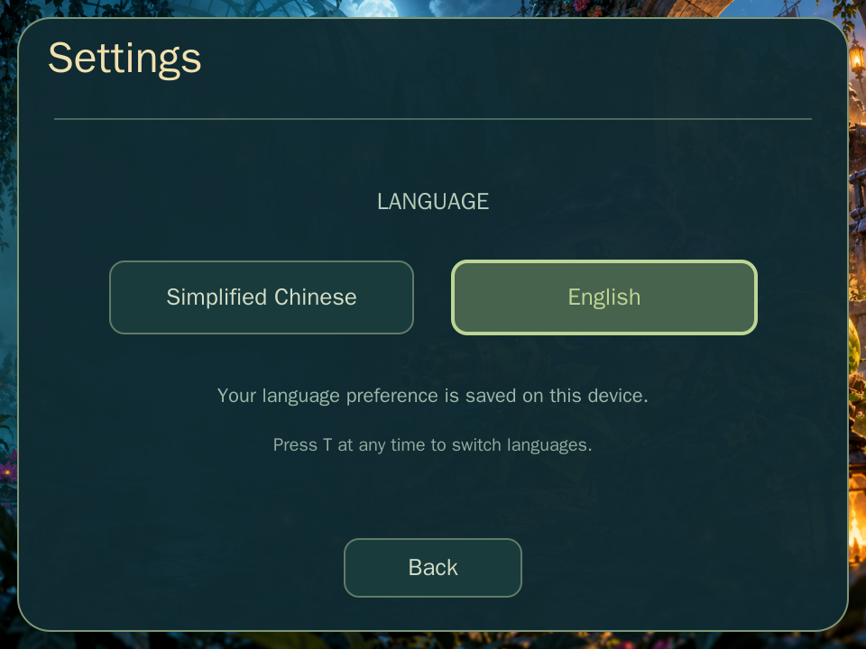

# 闯关存档与中英文

[返回项目说明](../README.md) · [English guide](README.en.md)

## 首页与语言

首页有开始游戏、读档、设置、实验室四个按钮。设置中点击中文 / English，或任意页面按 T，语言会保存到本机。菜单、职业、进化、关卡、Boss、增益、存档状态和浏览器备份对话框都提供双语。

## 关卡解锁

新档仅第一关开放，通关当前关卡后开放下一关，已经通过的关卡可以重玩。选关可浏览锁定关，但开始、确认职业、手动建立检查点和继续游戏都会检查解锁范围。主题快捷键也不能绕过锁定。

旧 TG2 如果保存了尚未通关解锁的高关卡，迁移时将检查点限制到“最高通关 + 1”，并清空那个检查点的起点得分 / 击退数；已有最高通关记录保留。TG1 没有关卡记录，从第一关开始。

## 存档范围

自动保存金币、累计收入、豌豆 / 蘑菇 / 西瓜三条进化档位、最高通关、语言。开始 / 重试 / 通关保存关卡起点、单双人模式、双方职业以及起点得分与击退数。只有一个检查点，开始新局会覆盖它。

首页读档 → 继续存档，或在首页 / 选关 / 读档页按 N。继续从本关起点恢复双方生命与满耐久脑子屏障、重建敌人与道具，保留永久收入和路线。不会恢复半途位置、子弹、临时增益、屏障损耗或 Boss 半途血量。

O 手动保存本关起点；选关时仅可把已解锁的选择写成新检查点。读档页可点击导出备份 / 恢复备份，也支持 C / V。恢复替换本机钱包、路线、检查点、解锁和语言，取消或无效码不会修改原进度。

## TG3 与旧档兼容

存储键仍为 `twilight-garden.progress.v1`。新码格式为 `TG3|金币|豌豆档|累计收入|检查点关卡|起点得分|起点击退|双人标记|最高通关|语言|蘑菇档|西瓜档|1P职业|2P职业|校验`。职业 0/1/2 分别对应豌豆 / 蘑菇 / 西瓜，语言 0/1 对应中文 / English。

TG1、TG2 继续可读，旧进化迁移到豌豆，另外两路线为 0。TG3 检查字段范围、规范格式、校验和三条路线的总花费，发现损坏时保留旧数据。校验用于意外损坏检测，不是防作弊加密。

浏览器存储写入后会读回确认；失败会显示待存并重试。启动无法读取旧档时，先阻止购买与覆盖，恢复可读后合并期间收益，并保留主动选择的新语言和检查点。

这是同浏览器配置、同站点来源的本机存档；不是账号登录或云同步。清理站点数据会删除进度，换设备 / 浏览器需备份迁移。同来源多个副本会共用这份数据，没有多标签页冲突合并。
